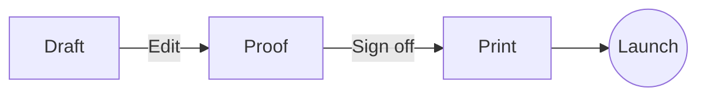

# Launch Plan

Everything needed to get the autumn issue out of the door.

## Schedule



## Budget

| Item | Cost |
| :--- | ---: |
| Printing, 500 copies | £1,150 |
| Postage | £320 |
| Launch evening | £480 |

$$
\text{cost per copy} = \frac{1150 + 320 + 480}{500} = 3.90
$$

## A snippet for the mail merge

```swift
let greeting = "Dear \(reader.firstName),"
print(greeting)
```

> [!TIP]
> Order the paper stock before **Friday**. Prices go up after that.
